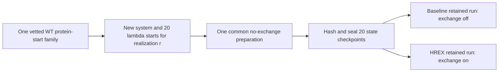

# F64A C2 design decisions after the paired technical scout

**Subsequent result, 2026-10-03:** The [live checkpoint-branch fixture](f64a_c2_branch_fixture_result.md)
passed. The selected shared no-exchange branch now has bounded execution
evidence. The [post-fixture production design review](f64a_c2_post_fixture_production_design.md)
updates source ancestry and remaining admission choices. The earlier
pre-fixture statements below are preserved as design history.

Status: **CPU-only design draft, 2026-09-30**. This extends the
[arm definition](f64a_c2_arm_definition_draft.md),
[precision/resource sensitivity](f64a_c2_precision_resource_draft.md), and
[accepted paired scout](f64a_c2_scout_hrex_result.md). It does not set a
production duration, repeat count, budget, or execution authorization.
The completed historical campaign remains stopped at 15 ns. C2 concerns
only a fresh F64A **folded-leg** comparison, not a folding ΔΔG or a renewed
validation-gate claim.

## 1. What the comparison would estimate

The primary question is the difference in observed sampling stability and
across-realization dispersion when each method receives the **same total
allocated GPU cost**, including its share of common preparation and all
arm-specific preparation, first lights, failed attempts and resumes. The
unit is one complete independently initialized 20-state ladder. Twenty
states or walkers within one ladder are not independent repeats.

The accepted 100-ps scouts measured dynamics-only rates of **0.552168**
baseline and **0.241447** HREX ns/state per allocated GPU-hour on the
one-L40S/20-rank layout, a ratio of **0.43727**. That is a short-run
resource anchor, not a long-run speed law. If the ratio held and the two
arms had equal overhead, equal cost would give HREX approximately 44% of
baseline's retained physical time. The primary outcome would therefore
compare **method plus attainable exposure at equal cost**. It cannot by
itself isolate exchange at equal simulated time.

Predeclare a secondary comparison on the overlapping retained duration
`min(T_B,T_H)` with the same estimator and time split in both arms. Label
it a common-duration diagnostic; it does not replace the equal-cost
primary analysis or erase the longer baseline trajectory and its cost.
Report both signed and absolute early-to-late movement and the final-half
across-ladder spread, with all individual results and actual costs.

## 2. Exact retained-time windows to register

Use the candidate **1-ps all-state energy grid** that the paired scout
validated, if it remains the selected production output setting. Let
`t=0` be the end of the fixed common preparation interval. If a
post-branch output contains a boundary record at `t=0`, preserve it for
integrity and exclude it from both disjoint estimation blocks; if GROMACS
does not emit that record, do not fabricate it. Require the retained
`t=1,2,...,T_m` ps grid explicitly. Choose each arm's retained target `T_m` as
an **even integer number of picoseconds** before submitting any scientific
run. For `N_m=T_m/(1 ps)`, use exactly `N_m/2` records per block:

| Block | Retained-time records from the arm's own fixed preparation endpoint |
| --- | --- |
| Early | `t=1,2,...,N_m/2` ps |
| Late | `t=N_m/2+1,...,N_m` ps |

This discrete boundary rule excludes any `t=0` record and duplicates no
energy record. It implements the publication plan's disjoint early/later halves
on a sampled grid; the plan's continuous `[0,T/2)` / `[T/2,T)` notation
must be updated in the final registration to match these actual columns.
Do not change the target, split or trimming after examining C2 energies.
The primary policy is zero additional trimming after fixed preparation,
with correlation treatment fitted within each allowed block. Fixed-25%
and adaptive policies remain prespecified sensitivity analyses and do not
choose a favorable result.

For the primary equal-cost contrast, the two arms' early/late blocks may
span different ns/state. Report their absolute intervals and the final
allocated cost. The common-duration secondary analysis applies this same
record rule to the shared prefix; it is not an extra independent repeat.
Define a minimum usable block length and complete-repeat requirement
before registration. The 100-ps scouts supply no evidence that a 3–7-ns
HREX late block is scientifically adequate.

## 3. Fresh-start ancestry and pairing

The current candidate is **one verified prepared WT F64A folded apo-2SH
protein-start family**. The historical local prepared `wt_apo.pdb`
candidate has SHA-256
`394776d7388e79c8de7ecd46b96b16c1eaf3aaa3a7e4a4a1a2173db397bc6f29`;
its chain/source provenance, chemistry and actual SCC copy must be checked
before it becomes a production input. The 3ECU chain-B comparison is an
unselected reserve, not an established second basin. Do not select another
protein conformation from a favorable F64A ΔG or call solvent replicas
independent protein conformations. With one family, conclusions are
conditional on that family.

For each realization `r`, build one **new** 20-state hybrid system, with
the mature F64 identity, apo/no-metal state, reduced Cys57/Cys146,
topology/includes, box/ions and per-state lambda-aware minimization
verified. Record the actual prepared WT hash, system seed, topology and
coordinate hashes, atom/ion counts, box, all 20 state-start hashes and
lambda vector. The existing GROMACS/pmx builder keys `genion` placement
by `(variant, leg, r, system)` when
`fep.independent_replicate_systems=true`; stochastic sampling seeds are
also repeat/state-specific. `gmx solvate` may otherwise reproduce the
same water template, so distinct `system_r` directories alone do not
prove independent solvent coordinates or conformational coverage.
Audit pairwise system hashes and water/ion coordinates before describing
the realizations' actual differences.

For a given `r`, use the verified state starts and initial velocity seeds
for one common no-exchange preparation, then copy its sealed 20-checkpoint
set into isolated baseline/HREX arm trees. Keep the physical Hamiltonians,
force field, lambda order, state labels, output cadence and estimator
identical. Freeze a distinct exchange seed for HREX; the baseline has
exchange disabled. The scout could use byte-identical TPRs because both
arms ran 50,000 steps. **Production arm TPRs may differ in `nsteps` under
equal cost**; compare their effective physical/output fields and
checkpoint ancestry directly, allowing only the registered duration and
exchange controls to differ. Never assert byte-identical production TPRs
when their step targets differ.

## 4. Selected design branch and its resource consequence

**Design choice recorded from the user:** use one **shared, no-exchange
preparation** per realization, then branch its validated 20 checkpoints
into isolated baseline and HREX retained runs. Exchange is disabled during
the common preparation and enabled only in the HREX branch afterward.
This specifies the intended scientific contrast; it does not select the
preparation duration, retained targets, exchange interval, CPU/GPU
implementation or production allocation. The historical
folded-leg setting is **2 ns** of fixed preparation before retained MBAR
samples; carrying that value into C2 is a candidate, not a demonstration
of equilibration. Count common preparation GPU time once in the paired
ledger and allocate half to each arm for equal-cost planning.

| Candidate | Exchange during fixed preparation | Branch and cost treatment | Interpretation |
| --- | --- | --- | --- |
| **Shared preparation before branch — selected design** | Off for one common 20-state preparation trajectory per realization | Validate a complete 20-checkpoint branch and start each arm from its identical prepared state; count common GPU time once and allocate half to each arm | Isolates exchange during retained sampling; the shared starting trajectory can induce pair dependence but does not justify a paired interval without evidence. |
| Separate arm preparation — sensitivity only | Off in baseline; on in HREX | Each arm starts from identical per-realization state inputs/seeds, prepares for the same physical time, and pays its own GPU cost | Would compare the full exchange-enabled preparation plus retained protocol; it is not the chosen C2 contrast. |

The exact-r6 checkpoint/TPR branch has a
[CPU-only design and static code review](f64a_c2_checkpoint_branch_review.md).
It is **not technically qualified**: Stage P proved a same-tree appended
whole-ladder restart, while the scouts used separate fresh starts. Neither
tested fan-out of one sealed checkpoint set into two isolated output trees.
The review defines the CPU input checks and bounded branch fixture needed
before an executable production package is selected.

For every realization, the common phase must end at the same registered
step/time with 20 valid lambda-state checkpoints; hash them and preserve
the unmodified common-phase output. Both branches must start from copies
of the same checkpoint set without resampling velocities, write to
distinct output trees and produce unique post-branch energy and
coordinate records. Their effective TPRs must match in physical and
output settings except for registered duration/continuation fields.
The baseline must show no exchange and HREX must show a complete
post-branch permutation history. Record and charge common preparation
separately; failures and resumes cannot silently extend a target.

With the scout dynamics rates as a sensitivity only, shared preparation
with equal arm overhead gives `T_H ≈ 0.43727 T_B` before rounding to the
energy/checkpoint grid. The unselected separate-preparation sensitivity,
in which each arm performs 2 ns at its own scout rate, would instead give
`T_H ≈ 0.43727(T_B+2)−2` ns. Thus the existing 8/16/32-ns baseline
probes imply illustrative HREX retained times of **3.50/7.00/13.99 ns**
for the selected shared-branch design, or **2.37/5.87/12.87 ns** for the
unselected separate 2-ns sensitivity. These are not production targets: preparation rates,
long-run dynamics and failure costs have not been measured, and target
steps must be frozen to a valid grid before any run.

## 5. Admission ledger still missing

The [resource draft](f64a_c2_precision_resource_draft.md) carries the
user's **0.5–1.0 kcal/mol** useful-movement-reduction sensitivity range,
the idealized repeat/precision cases and the scout-rate cost scenarios.
It does not select a single useful-effect threshold or show power for the
dispersion co-primary endpoint. A nominal unpaired half-width no greater
than 1.0 or 0.5 kcal/mol at assumed `σ_M=0.70` requires 6 or 17 complete
ladders per arm, respectively; duration-dependent variance and missing
ladders may change that substantially.

The two completed scout attempt trees occupy **241,769,928 bytes** together.
Their compressed trajectories averaged about **140,499 bytes per stored
state-frame**. An XTC-only extrapolation gives 1.96/6.49/20.73 GB for
the A/B/C sensitivities with the shared-preparation duration ratio.
These omit energies, fixed input/final-coordinate/checkpoint costs,
failed attempts and copies; the largest trajectory-only case is already
close to the prior `/project` quota headroom. Choose checkpoint retention,
failure reserve and mechanism-capable coordinate cadence, then build a
full per-arm storage ledger against a fresh project quota snapshot.

Before any executable production registration, fill in **all** of:

1. One scientific useful-effect threshold within the 0.5–1.0 range and
   a justified dispersion target; choose complete-repeat count and fixed
   retained durations from expected precision and usable block lengths.
2. The shared no-exchange preparation's exact duration, exchange timing
   after the branch, checkpoint/TPR mechanics and fresh-start ancestry.
3. Actual long-run arm rates and uncertainty, common/arm-specific GPU
   preparation, first-light/failure/resume allowances and immutable
   equal-cost target steps; record requested slot-hours and billed SU
   separately. The SU tariff/balance are still unknown.
4. Complete storage by type and retention, fresh `/project` quota and
   safety reserve, structural cadence adequacy, per-job wall limits,
   attempt caps and stop rules.
5. An analysis/uncertainty method for the movement and spread contrasts,
   fixed sample cuts, missing-ladder treatment and an independent review
   of the final effective MDP/TPR differences.

The next reversible work is the reviewed branch contract's CPU input
implementation and read-only archived ancestry/cost review. This document is a design draft; it
creates no cluster job or authority for one.
